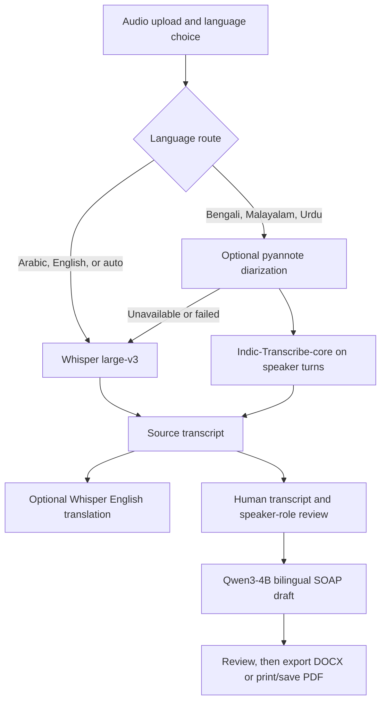

# Voice to Text — Healthcare Medical

A local-first research prototype for transcribing synthetic, multilingual medical consultations, reviewing speaker turns, translating transcripts into English, and drafting bilingual SOAP summaries.

- **Languages:** Arabic, Bengali, Malayalam, Urdu, and English.
- **Project type:** Internship research prototype.
- **Current dataset:** Four synthetic ElevenLabs consultation recordings, one per regional language.
- **Clinical status:** Experimental; outputs are drafts and are not validated medical records.

## Project overview

This project studies an end-to-end workflow for healthcare speech-to-text in four regional languages. A user uploads a consultation recording, selects a spoken language, reviews the source-language transcript and optional English translation, checks anonymous speaker labels, and can request a bilingual SOAP draft. Transcript editing and explicit human-review steps are built into the dashboard before report export.

The current audio set uses synthetic text-to-speech recordings based on a shared English consultation scenario. It is a small pilot dataset: it does not represent the range of real clinical speech, dialects, accents, recording conditions, or multi-speaker overlap found in practice.

## Capabilities

- Upload MP3, WAV, M4A, FLAC, OGG, or WebM audio through a browser dashboard.
- Select Arabic, Bengali, Malayalam, Urdu, English, or automatic language detection.
- Transcribe locally with a language-routed open-source ASR pipeline.
- Request a local English translation for non-English audio.
- View timestamped segments and, when diarization is available, anonymous speaker IDs.
- Edit, copy, and download source-language and English transcripts.
- Manually assign verified doctor, patient, and nurse roles.
- Generate a bilingual English and conversation-language SOAP draft after transcript and role review.
- Review report evidence and export a Word document or print/save a PDF draft.
- Keep uploaded audio in temporary storage and remove it after the request completes.

## Architecture and model routing



| Stage | Current model / component | Notes |
|---|---|---|
| Arabic, English, automatic ASR | OpenAI Whisper `large-v3`; `mlx-community/whisper-large-v3-mlx` on Apple Silicon when MLX is available | CPU fallback uses the Whisper `large-v3` checkpoint. |
| Bengali, Malayalam, Urdu ASR | [Bodhan AI / AI4Bharat Indic-Transcribe-core](https://huggingface.co/bodhan-ai/indic-transcribe-core) | The backend uses it on diarized speaker turns because the model is intended for single-speaker input. If diarization or model access fails, it falls back to Whisper on the full recording. |
| Speaker diarization | [pyannote Community-1](https://huggingface.co/pyannote/speaker-diarization-community-1), optional | Produces anonymous speaker IDs and intervals. It does not identify who is the doctor, patient, or nurse; a person must verify those roles. |
| English translation | Whisper `large-v3`, local inference | Translation may be slower and can mistranslate symptoms, values, names, and medical terms. |
| Bilingual SOAP draft | [Qwen3-4B-Instruct-2507](https://huggingface.co/Qwen/Qwen3-4B-Instruct-2507); 4-bit MLX build on Apple Silicon | Candidate general-purpose language model, not a clinically validated model. The older Qwen2.5-1.5B adapter is not the default report model. |

Whisper is available from the [official OpenAI Whisper repository](https://github.com/openai/whisper). Model terms and licenses vary; review the relevant model cards before redistribution or deployment.

## Dashboard workflow

1. Start the backend and open the local dashboard URL.
2. Select a recording and the language spoken in it.
3. Run transcription. The source transcript, anonymous speaker labels, and English translation (when available) appear in the results panel.
4. Listen to the recording and correct the source transcript and translation. Pay particular attention to medication names, measurements, units, family history, and speaker changes.
5. Assign doctor, patient, and nurse labels only after listening and confirming the voices.
6. Enter the fluent reviewer’s name and confirm the transcript and role-review prompts.
7. Generate the bilingual SOAP draft. Review every section against the audio and source evidence.
8. Export the reviewed draft as Word or use the browser’s print dialog to save a PDF.

The report endpoint refuses to silently truncate overlong input. Automated evidence and format checks are safeguards; they do not establish that the report is factually correct.

## Run locally

### Requirements

- macOS on Apple Silicon for the MLX-accelerated path, or a supported CUDA environment for report generation.
- Python 3.12 is recommended for the local Apple Silicon environment.
- `ffmpeg` for audio decoding.
- Internet access for the first model download.
- Optional Hugging Face access and authentication for gated diarization/model downloads.

### Install and start

From the repository root:

```bash
brew install ffmpeg python@3.12
python3.12 -m venv .venv
source .venv/bin/activate
python -m pip install --upgrade pip
python -m pip install -r backend/requirements.txt -r backend/requirements-diarization.txt -r backend/requirements-report.txt
uvicorn backend.main:app --host 127.0.0.1 --port 8000
```

Open [http://127.0.0.1:8000](http://127.0.0.1:8000) for the dashboard or [http://127.0.0.1:8000/docs](http://127.0.0.1:8000/docs) for the API schema. Keep the terminal running while using the dashboard. If port 8000 is already occupied, stop the existing server or start this one on another port and open that same port in the browser.

The first request may take longer while model weights download and load. Model files are cached locally afterward. In a headless environment without Apple Metal, set `ASR_BACKEND=cpu` before starting the server.

### Optional Hugging Face setup

Accept the access conditions for the required Hugging Face models in your account, then log in locally with a read token:

```bash
hf auth login
```

The token authorizes model downloads. Never paste it into source code, README files, notebooks, or Git. Do not commit `.env` files or credentials.

## API overview

The FastAPI backend exposes:

- `GET /api/health` — service status, model routing, and report-generation dependency status.
- `POST /api/transcribe` — accepts an audio file and language selection; returns recognized text, language/model metadata, segments, speaker information where available, and English translation status.
- `POST /api/report` — creates a bilingual SOAP draft from a human-reviewed transcript and verified speaker roles.
- `POST /api/report/docx` — returns a reviewed report draft as a Word document.

The dashboard provides the print-to-PDF workflow in the browser. Uploaded audio is held in a temporary file during processing and deleted after the request. Model downloads require network access; inference is local and no paid speech or LLM API is used by the default backend.

## Research and evaluation status

The repository contains Colab workflows for ASR experiments, diarization, and guarded report generation. WhisperX `large-v3-turbo` and SeamlessM4T v2 Large were explored as ASR candidates. Script-family checks can indicate whether output uses the expected writing system, but they do not measure word or clinical correctness.

**No defensible end-to-end clinical accuracy score is currently available.** The exact regional-language ElevenLabs input text is not confirmed for every recording, the reference-aligned transcripts have not all been verified by fluent listeners, and report drafts are experimental. Existing WER/CER comparisons against reconstructed drafts are provisional and must not be presented as benchmark accuracy. Likewise, report-generation format checks and source-line checks are not clinical accuracy scores.

To produce reportable results:

1. Recover the exact text supplied to ElevenLabs or create a fluent, verbatim reference transcript from each recording.
2. Have fluent reviewers verify the transcript, numbers, medical terms, and speaker turns; resolve disagreements with a second reviewer.
3. Compute WER and CER against those verified references, with consistent normalization for punctuation, numerals, and language-specific tokenization.
4. Have a qualified reviewer create a reference SOAP report from the verified transcript.
5. Score each report’s facts as correct, omitted, contradicted, or unsupported. Report critical measurements, diagnoses, and medication instructions separately from general summary coverage.
6. Evaluate more independent recordings per language before making generalization claims. Four synthetic recordings are only a pilot sample.

The currently observed outputs include mistranscribed family-history content, uncertain medication spellings, missing or altered clinical details, and unreliable saved Malayalam text. Speaker-role assignments also require listening-based verification. The candidate report model may omit relevant symptoms or add unsupported instructions. See the review artifacts under `outputs/` before interpreting any result.

## Privacy, safety, and intended use

- This is a research and demonstration prototype, not a diagnostic system, medical device, or substitute for professional documentation.
- Do not use generated text as a clinical record or treatment recommendation without qualified human review.
- Always verify the transcript, English translation, speaker attribution, numeric values, units, diagnoses, and medicines against the recording.
- Audio is processed locally by the backend and deleted from temporary storage after a request. Generated transcripts and reports may be downloaded or stored by the user.
- The system downloads open-source model weights on first use; network access is used for model retrieval, not to send audio to a paid inference API.
- The project’s synthetic audio does not represent real patients and should not be treated as evidence of clinical performance.

## Repository guide

| Path | Contents |
|---|---|
| `backend/main.py` | FastAPI routes, model routing, transcript/report validation, and export logic. |
| `backend/requirements*.txt` | Core, diarization, and report-generation dependencies. |
| `backend/README.md` | Detailed local setup and backend limitations. |
| `outputs/dashboard/index.html` | Browser dashboard for upload, transcript review, language translation, roles, and reports. |
| `outputs/TASK_4_Stage_1_ASR_Diarization.ipynb` | Colab ASR and diarization workflow. |
| `outputs/TASK_4_Clinical_Report_Generation_Guarded.ipynb` | Guarded bilingual report-generation workflow. |
| `outputs/TASK_4_Multilingual_Clinical_Benchmark.ipynb` | Multilingual experiment notebook. |
| `outputs/reference_transcripts/` | Reference-aligned transcript drafts and selected raw ASR results; review status is documented per artifact. |
| `outputs/diarization/pyannote/` | Anonymous diarization intervals and RTTM exports. Role labels are not independently verified. |
| `outputs/review_audio/` | Review queues, spot-check notes, and instructions for transcript and speaker review. |
| `outputs/four_language_asr_run_20261105/` | Four-language run notes, raw outputs, bilingual candidate drafts, and provisional comparison files. |
| `outputs/report_drafts_unverified/` | Experimental Qwen3-4B report candidates, explicitly marked unverified. |
| `outputs/clinical_report/` | Example report exports. Treat them as drafts unless a reviewer confirms otherwise. |
| `outputs/final_adapter.zip` | Recovered legacy Task 3 LoRA adapter; not the default report model. |

Original audio files are kept outside this repository. Dataset manifests use filenames rather than machine-specific absolute paths. Some experimental artifacts, such as the Arabic single-voice TTS preview, are not the original three-speaker recording; artifact-specific notes explain these distinctions.

## Acknowledgements

This project uses open-source speech and language models, including OpenAI Whisper, Bodhan AI / AI4Bharat Indic-Transcribe-core, pyannote Community-1, and Qwen3. Please refer to each model’s official repository or model card for its license, intended use, and citation requirements.
